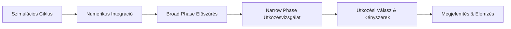

# Egyedi 2D fizikai motor játékokhoz

## 1. Szereplők és jogosultságok

| Szerep | Igény | Felelősség / hozzáférés |
| --- | --- | --- |
| Fejlesztő / Felhasználó | Ellenőrzött tesztjelenetek létrehozása és a szimuláció futtatása | Beállítja a paramétereket, futtatja a szimulációt, rögzíti és elemzi a fizikai mérőszámokat. |

## 2. Use case-ek / user storyk

### Szimulációs tesztjelenet futtatása és mérése

- **Szereplő:** Fejlesztő / Felhasználó
- **Előfeltétel:** A fizikai motor inicializálódott és a tesztjelenet betöltődött.
- **Fő folyamat:**
  1. A szereplő kiválaszt vagy létrehoz egy ellenőrzött tesztjelenetet (pl. ütköző testek, lejtő, kényszerek).
  2. A rendszer inicializálja a merevtesteket és a geometriai primitíveket.
  3. A szereplő elindítja a szimulációt állítható időlépésekkel és paraméterekkel.
  4. A rendszer végrehajtja a szimulációs ciklust: numerikus integráció, broad phase előszűrés, narrow phase ütközésvizsgálat, kontaktusok meghatározása és ütközési válasz kiszámítása.
  5. A rendszer megjeleníti a testek mozgását és a kimeneti mérőszámokat (pl. behatolási hiba, energiaviselkedés, számítási költség).
- **Alternatív / hibafolyamatok:** Túl nagy időlépés esetén a numerikus instabilitás (drift vagy "szétrobbanó" szimuláció) felléphet, amit a rendszer naplóz vagy megjelenít.
- **Utófeltétel:** A kísérleti adatok és a fizikai viselkedés dokumentálhatóvá válnak.

## 3. Funkcionális követelmények

| Követelmény | Elfogadási kritérium | Prioritás |
| --- | --- | --- |
| A rendszer támogatja a merevtestek numerikus integrálását. | Adott időlépésnél a testek helyzete és sebessége a megadott integrációs módszer (pl. Euler, Verlet) szerint frissül. | Kötelező |
| Az előszűrés (broad phase) és pontos ütközésvizsgálat (narrow phase) szétválasztott. | A potenciális ütköző párok szűrése megtörténik a részletes geometriai metszetvizsgálat előtt. | Kötelező |
| Kezeltek a BSc-szinten ésszerű geometriai esetek. | A rendszer támogatja legalább a köröket, tengelyekkel párhuzamos téglalapokat (AABB) vagy konvex sokszögeket. | Kötelező |
| Az ütközési válasz kezeli a rugalmasságot és a súrlódást. | Ütközéskor az impulzus alapú dinamika helyesen módosítja a testek sebességét restitúció és súrlódás mentén. | Kötelező |
| A pozíció korrekció csökkenti a behatolási hibát. | Egymásba hatoló testek esetén a korrekciós lépés stabilizálja a kontaktust. | Kötelező |
| A felhasználó mérheti a teljesítményt és a skálázhatóságot. | Változó testszám mellett a rendszer rögzíti és megjeleníti a számítási költséget. | Kötelező |
| Egyszerű kényszerfeltételek és forgás támogatása. | A testek képesek forogni nyomaték hatására, és egyszerű csuklók vagy távolságkényszerek alkalmazhatók. | Ajánlott |

Prioritás: **Kötelező** = a végtermékhez szükséges; **Ajánlott** = fontos; **Lehetséges** = idő esetén opcionális.

## 4. Üzleti szabályok és korlátok

| Szabály vagy korlát | Indoklás |
| --- | --- |
| A játékmotor beépített fizikai alrendszere nem használható a vizsgált testek szimulációjára. | A projekt célja a saját fizikai motor önálló megvalósítása és értékelése. |
| Titkos kulcsok, hozzáférési tokenek, személyes és éles adatok nem kerülhetnek a repóba. | Biztonsági és verziókezelési alapelv. |
| A validáció ismert vagy előre jelezhető kimenetű tesztesetekre épül. | Biztosítja a fizikai helyesség és a numerikus stabilitás ellenőrizhetőségét. |

## 5. Felhasználói felület és munkafolyamat

A rendszer egy vizuális megjelenítő felületet (pl. Unity, Godot vagy saját renderelő kontextus) használ a szimuláció futtatásához és valós idejű követéséhez. A kezelőfelületen keresztül indíthatók az ellenőrzött tesztjelenetek, módosíthatók a fizikai paraméterek (pl. gravitáció, restitúció, időlépés), és megfigyelhetők a teljesítménymérőszámok.

## 6. Nem funkcionális követelmények

| Követelmény | Ellenőrzés módja |
| --- | --- |
| A szimulációs ciklus stabil marad determinisztikus tesztesetek alatt. | Hosszú távú futtatási tesztek és energia-megmaradási vizsgálatok. |
| A megjelenítés korlátozott testszám mellett valós időben (min. 60 FPS) fut. | Teljesítményprofilozás különböző testsűrűségeknél. |
| A forráskód jól struktúrált, verziókezelt (Git). | Kódellenőrzés és repó struktúra vizsgálata. |

## 7. Nyitott kérdések és kockázatok

| Kérdés / kockázat | Hatás | Felelős | Feloldás / döntés |
| --- | --- | --- | --- |
| Milyen mértékű numerikus drift lép fel az integrátoroknál? | Befolyásolja a hosszú távú stabilitást. | Hallgató | Különböző időlépések és integrációs módszerek (pl. Verlet) tesztelése. |
| Hogyan küszöbölhető ki a komplex sokszögek ütközési hibája? | Pontatlan ütközési választ eredményezhet. | Hallgató | A geometriai esetek szűkítése konvex sokszögekre és SAT alapú tesztekre. |

## 8. Kezdeti technikai javaslat

### Javasolt megoldás

A rendszer moduláris felépítésű szoftverként valósul meg, amely különválasztja a matematikai segédosztályokat, a dinamikai integrátort, az ütközésdetektálási pipeline-t (broad/narrow phase) és a kényszermegoldót. A megjelenítéshez külső keretrendszer (pl. könnyűsúlyú grafikus keretrendszer vagy játékmotor megjelenítő rétege) használható, de a fizikai számítások kizárólag a saját implementációból származnak.

### Technológiai irány

| Terület | Jelölt technológia / megközelítés | Megfontolás oka | Nyitott kérdés / kockázat |
| --- | --- | --- | --- |
| Programozási nyelv | C++ / C# / Python / TypeScript | Hatékony numerikus számítások és objektumorientált szerkezet | A választott nyelv teljesítménybeli korlátai. |
| Megjelenítés | Unity / Godot / Custom Canvas | Gyors grafikus kimenet biztosítása fizikai motor nélkül | A grafikus motor fizikai moduljának szigorú elkerülése. |
| Verziókövetés | Git & GitHub | Biztonságos verziókezelés és reprodukálhatóság | Tokenek és kulcsok kizárása a commitokból. |

### Kezdeti architektúravázlat

### Megvalósíthatóság és technikai kockázatok

| Kockázat / feltételezés | A projektre tervezett validáció | Tartalék megközelítés |
| --- | --- | --- |
| A numerikus instabilitás felborítja a verembe rendezett testeket. | Kísérletek különböző időlépésekkel és pozíció-korrekciós szintekkel. | Sub-stepping (részidőlépések) bevezetése a stabilabb megoldás érdekében. |
| A SAT alapú poligon ütközés túl lassú nagy testszámnál. | Teljesítménymérések és skálázhatósági tesztek az ütközéssűrűség függvényében. | Spatial partitioning (pl. Grid vagy BVH) alkalmazása a broad phase fázisban. |

